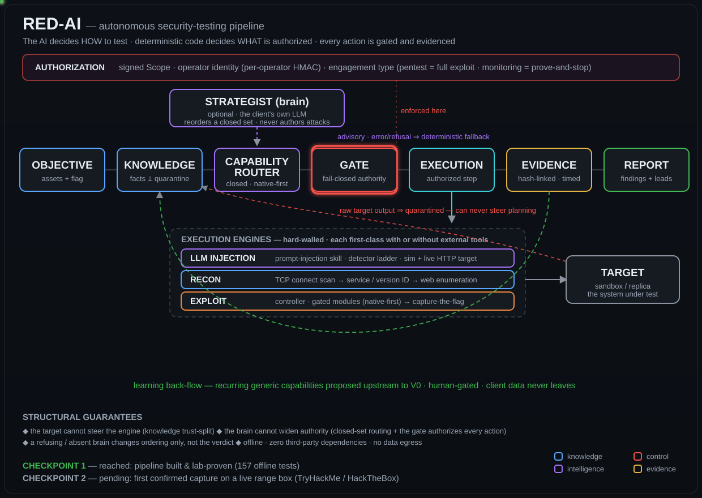

# RED-AI

*Attack your AI before attackers do — under explicit authorization, offline.*

RED-AI is an authorized adversarial security-testing framework for AI
applications. It runs an adaptive attacker against a target, proves boundary
failures with evidence (not model chatter), measures how reliably they
reproduce, and reports the **weakest link plus a reproduction** — never a
pass/fail stamp.

**v1.0 — merged foundation.** One clean package merging two prototypes: the
`RED-AI_Self` control/evidence/replay spine and the `redai` product model +
detector ladder + adaptive planner. Zero third-party dependencies; runs on a
bundled Python with no network and no API key. Targets are synthetic
simulations only in this release.

## Architecture at a glance

<p align="center">
  <a href="https://github.com/Haryshwa29/Red-AI/blob/main/docs/architecture.svg">
    
  </a>
</p>
<p align="center"><sub><b>▶ Click the diagram to open it full-size</b> (zoomable vector, animated) · or see the detailed <a href="docs/ARCHITECTURE_DIAGRAM.md">Mermaid breakdown</a></sub></p>

Data flows **Objective → Knowledge → Capability Router → Gate → Execution →
Evidence → Report**, with three hard-walled engines (LLM injection · recon ·
exploit), an optional reorder-only strategist, and a human-gated learning
back-flow. A detailed, native-rendering **Mermaid breakdown** is in
[`docs/ARCHITECTURE_DIAGRAM.md`](docs/ARCHITECTURE_DIAGRAM.md); the full prose
design is in [`ARCHITECTURE.md`](ARCHITECTURE.md).

## The one principle

> The AI decides **how** to test. Deterministic code decides **what it is
> authorized to do.** The planner proposes; the gate authorizes; the model
> never edits its own scope or guardrails.

## Quick start

```bash
cd RED-AI
python -m red_ai doctor                 # validate config/skills/signing, no scan
python -m red_ai demo --open            # naive/guarded/hardened sims + reports
python -m unittest discover -s tests -v # offline test suite (164 tests)
```

### Live engagement (recon → exploit → capture the flag)

Run on a machine with a route to the authorized target (e.g. connected to a
TryHackMe / HackTheBox VPN). One command runs recon, bridges what it discovered
into the exploit engine, and hunts the declared flag form — every step gated,
every event hash-linked, with a live timestamped stream:

```bash
python -m red_ai operator add <your-handle>          # one-time, per-operator key
python -m red_ai engage --target <box-ip> --ports 80,8080,8000,8888,443 --operator <your-handle>
python -m red_ai verify data/runs/<ts>-engage-exploit
```

Full procedure, box selection, and the honest scope of what captures today
(web boxes) vs. not yet (SSH brute / SQLi / RCE / privesc) are in
[`docs/THM_RUNBOOK.md`](docs/THM_RUNBOOK.md).

Single run against one simulation level:

```bash
python -m red_ai init-demo
python -m red_ai run --scope data/sim-naive.scope.json --level naive
python -m red_ai verify data/runs/<RUN_ID>
python -m red_ai report data/runs/<RUN_ID>

# reviewed-finding memory (operator attests, then it informs future ordering)
python -m red_ai promote data/runs/<RUN_ID> --finding <FINDING_ID> --reviewer "You" --approve
python -m red_ai run --scope data/sim-naive.scope.json --level naive --memory
python -m red_ai revoke <CASE_ID> --reviewer "You"

python -m red_ai stop        # operator kill switch (persists until resume)
python -m red_ai resume
```

### Attaching a local model (the brain)

```bash
# Ollama (default api): pull any local model, then point RED-AI at it
export RED_AI_MODEL_URL=http://localhost:11434
export RED_AI_MODEL=<your-model-tag>
python -m red_ai doctor          # probes the brain, stays READY if it's down
python -m red_ai run --scope data/sim-naive.scope.json --level naive

# OpenAI-compatible local server (llama.cpp / vLLM / LM Studio):
export RED_AI_MODEL_API=openai RED_AI_MODEL_URL=http://localhost:8080
```

> **Reaching the model across a boundary.** `localhost` only works when
> RED-AI and the model share a host. If RED-AI runs in a container and the
> model runs on the host (or elsewhere on the client LAN), point
> `RED_AI_MODEL_URL` at that address instead -- e.g.
> `http://host.docker.internal:11434` or the host's LAN IP. The address is
> the only thing that changes; nothing else in RED-AI assumes a location.

With no `RED_AI_MODEL_URL`, RED-AI uses the deterministic planner. If the
model is unreachable or replies with an out-of-set/garbled choice, that
*step* falls back to the heuristic -- a scan never stalls on the brain, and
`summary.json` records `model_decisions` vs `fallbacks` so each run is honest
about how much was model-decided.

Reports land in `data/runs/<run-id>/`: `events.jsonl` (hash-linked original
evidence), `summary.json`, `report.md`, `report.html`.

## What RED-AI is (and isn't) yet

Implemented: signed authorization scope, deterministic policy gate, budget /
timeout / cancellation, hash-linked evidence, adaptive explore/exploit planner,
3-tier detector ladder (tier-1 canary + tier-2 policy; tier-3 semantic is a
declared gap), derived-severity adjudicator, reproduction measurement, offline reports,
skill-plugin registry, model-provider seam with an offline mock, and a
reviewed-finding memory corpus (operator-attested, reproducible findings only,
with revocation and audit).

Also implemented (network side): a live HTTP **target adapter** for the LLM
engine, a **recon engine** (TCP connect scan → service/version ID → read-only
web enumeration), and an **exploit engine** that bridges recon discovery into a
gated, discovery-driven **web flag hunt** and captures the declared flag form
(`THM{…}`/`flag{…}`/`HTB{…}`/32-hex) with a reproduced, zero-false-positive
check — all driven by one `engage` command (see the runbook above).

Not yet: exploit coverage beyond web flag capture — SSH/FTP credential brute
force, SQL injection, LFI / path traversal, file-upload bypass, RCE, and
privilege escalation are each a planned, separately-gated module, not a silent
omission. Semantic tier-3 LLM detection remains a declared gap.

New in this build: a real local **model backend** behind the existing
`ModelProvider` seam (Ollama + OpenAI-compatible, stdlib-only, offline) and a
**model-driven planner** that lets the model choose *which technique* to try
next. Wording still comes from the auditable template bank and the gate still
authorises every move, so determinism and reproducibility are unchanged.

The **control plane** (`red_ai engine --scope F --level L`) is the unifying
engine: one loop over a Knowledge System (trusted facts vs quarantined target
text), an explainable Capability Router across the LLM and recon engines, an
explicit Plan/Hypothesis step (expected-vs-observed break), delegated execution
behind the existing gate, and the learning back-flow below. It records a
`control_plane.json` manifest with a pinned knowledge hash so an adaptive run
stays reproducible. The older `run`/`demo` path is unchanged.

A **learning / V0-upgrade back-flow** (`red_ai learn`) turns the client-local
reviewed memory into human-reviewed upgrade *proposals* for the shared V0
baseline. Nothing is applied automatically. A capability is proposed only when
it recurs across enough distinct targets to look generic, and every proposal is
split into a generic half (the only part eligible to ship to V0) and a
client-local provenance half that never leaves the instance -- enforced by a
leakage tripwire that fails the export closed. So the operator's review is a
review *for leakage*, not just for authority.

## Security model

- **Authorization is deterministic code.** A signed `Scope` carries the
  authoriser, environment, budgets, and allowed techniques; the gate enforces
  it before every action. Production targets require an explicit opt-in.
- **Evidence-first.** A model saying "I did X" is a claim, not a finding. A
  finding requires detector evidence appropriate to the claim.
- **A refusal is not safety.** The planner treats a refusal as one exhausted
  framing and keeps going; results read "not broken in N turns", never "secure".
- **Offline and dependency-free.** No network, no third-party packages, no API
  keys. Evidence is hash-linked for tamper *detection* against a trusted copy
  (not an immutable vault — stated, not hidden).

### Data residency (no data leaves the client network)

This is a hard design constraint, not a setting:

- **No third-party dependencies.** `dependencies = []`; RED-AI runs on a
  bundled Python, so there is no vendored client that could call home.
- **One egress path, and you choose where it points.** The *only* code in the
  package that opens a socket is the model provider
  (`red_ai/intelligent/providers/http.py`), and it connects solely to the
  `RED_AI_MODEL_URL` you set -- a model inside the client network. The target
  adapter (also in-network) is the only other outbound call. There is no
  telemetry, analytics, crash-reporting, or auto-update anywhere in the tree
  (`grep` the source: nothing but the provider touches the network).
- **Cross-client learning cannot carry client data.** The only path from one
  instance toward the shared baseline is `red_ai learn`, and it exports
  *generic capabilities only*. A leakage tripwire refuses any upstream payload
  that contains a client identifier and fails the whole export closed; client
  provenance stays in the local review report. Promotion into V0 is a separate
  human decision, never an automatic effect.
- **The brain is interchangeable and untrusted.** RED-AI works the same
  against an uncensored model, a safety-aligned model that refuses the
  strategy prompt, or no model at all -- the verdict is identical, proven by
  the `TestBrainIndependence` suite. Clients run whatever model their policy
  allows; RED-AI never requires a particular one, and never a hosted one.

See `ARCHITECTURE.md` for the full design.
