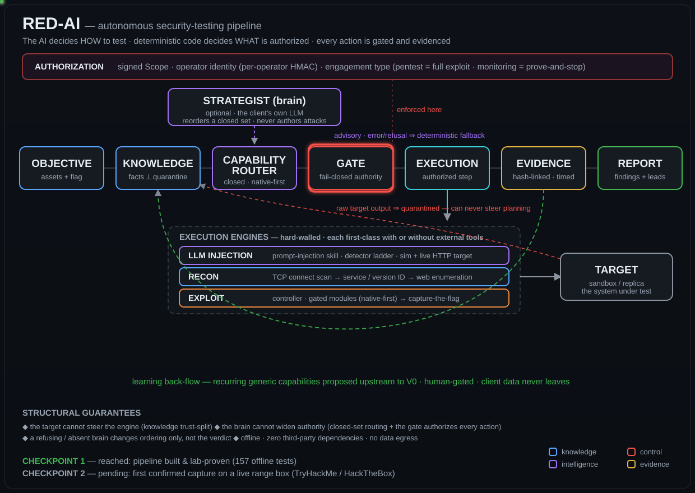
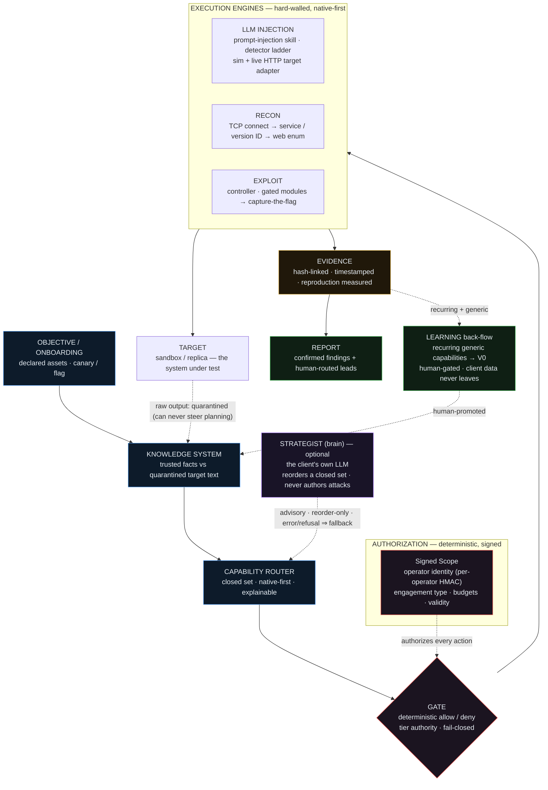

# RED-AI — Architecture Diagram

An animated overview plus a detailed, native-rendering breakdown. For the full
prose design see [`../ARCHITECTURE.md`](../ARCHITECTURE.md); for the model trust
boundaries see [`MODEL_ROLES_AND_TRUST.md`](MODEL_ROLES_AND_TRUST.md).

## Animated pipeline

  

<b>▶ Click to open full-size</b> (zoomable, animated)

> The SVG animates (data pulses flowing through the pipeline) via SMIL, which
> survives GitHub's image proxy. If your viewer shows it static, open
> [`architecture.svg`](architecture.svg) **raw** and it animates.

## Detailed flow

## How to read it

- **Two layers.** The *intelligent* layer (strategist, planners) only ever
  **proposes**; the *control* layer (signed scope, gate) **decides**. The model
  never touches its own guardrails or widens authority.
- **Three engines, hard-walled.** LLM injection, recon, and exploitation are
  separate engines surfaced to the router as uniform capabilities. Each is
  first-class with no external tools; tools (nmap/Burp/msf) only accelerate.
- **Trust split.** Raw target output is quarantined and never feeds planning —
  the indirect-injection-against-the-red-teamer defense.
- **Evidence-first.** A model claim is never a finding; a finding needs detector
  evidence, and every event is hash-linked and timestamped for an auditable,
  reproducible trail.

## Structural guarantees

| Guarantee | Enforced by |
|---|---|
| The target cannot steer the engine | knowledge trust-split (quarantine) |
| The brain cannot widen authority | closed-set routing + the gate authorizes every action |
| A refusing / absent brain changes ordering only, not the verdict | deterministic fallback + `TestBrainIndependence` |
| No data leaves the client network | zero third-party deps · single opt-in model egress · leakage tripwire on learning |
| Every output carries a *why* | confirmed finding = exploit evidence; lead = four-question contract |
