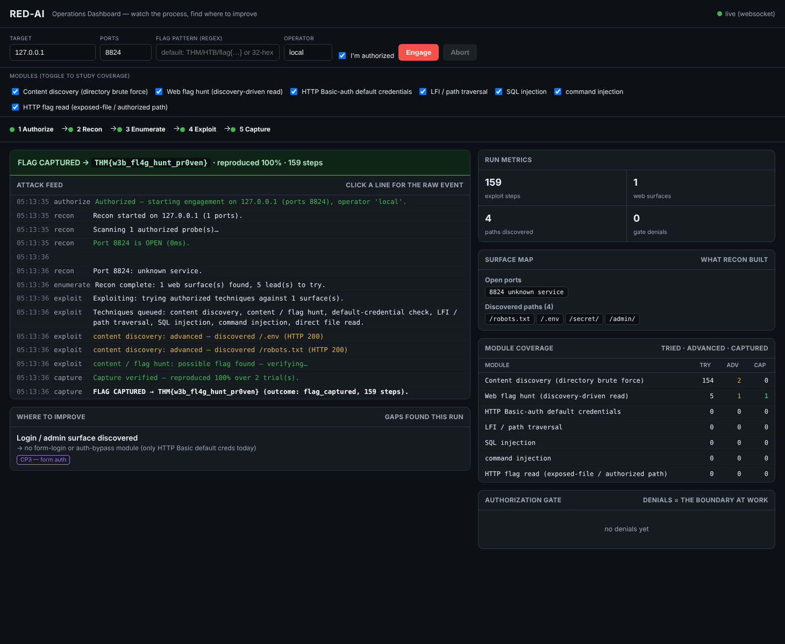

# RED-AI Operations Dashboard

An in-depth, realtime dashboard for driving engagements and **seeing how RED-AI
decides** — not just the result. It is the primary way to point RED-AI at a lab
(TryHackMe / HackTheBox) and watch recon → enumerate → exploit → capture unfold,
with enough visibility to decide *where to improve the engine*.

Dependency-free (stdlib `http.server` + a hand-rolled RFC-6455 WebSocket), bound
to `127.0.0.1`. It runs **on the machine that can reach the target** (the one on
the VPN); the browser is only the window.



## Running it

```bash
cd Red-AI
python -m red_ai web            # → http://127.0.0.1:8787
```

Enter the target IP, tick **I'm authorized**, press **Engage**. Streaming is over
WebSocket (status shown top-right); if the WebSocket can't open it falls back to
HTTP polling automatically. `--port` changes the port; `--host` prints a loud
warning if you bind anywhere but localhost.

## What each panel tells you

- **Control bar** — target, ports (default `1-1000` so recon finds the web port
  itself), an optional flag-pattern regex, operator, and the authorization tick.
- **Module toggles** — turn individual exploit modules on/off and re-run to study
  their effect on coverage. (These set the engagement's module allowlist, enforced
  by the gate.)
- **Phase strip** — Authorize → Recon → Enumerate → Exploit → Capture, lighting up
  as the run moves.
- **Attack feed** — the annotated, plain-English step log. **Click any line** to
  expand the raw structured event behind it.
- **Run metrics** — exploit steps, web surfaces, paths discovered, gate denials.
- **Surface map** — what recon built: open ports + services, every discovered
  path, and injectable parameters.
- **Module coverage** — per module, how many steps it **tried**, how many
  **advanced**, how many **captured**. This is where you see thin coverage at a
  glance (e.g. "SQL injection tried 7, advanced 0").
- **Authorization gate** — every *denied* step with its reason: the authorization
  boundary working in real time.
- **Where to improve** — when a run falls short, RED-AI lists what it *found but
  could not use* (an open SSH port, a login form, parameters it couldn't break)
  mapped to the missing capability and the checkpoint it belongs to. This turns a
  `no_breach` into a concrete next build.

## Security (unchanged, and important)

- **Localhost only by default.** This console launches attacks; do **not** expose
  it on the VPN/LAN.
- **Authorization still enforced.** Operator identity (auto-created `local` on
  first launch) + the explicit authorization tick, both recorded in the
  hash-linked evidence. Every exploit step is gated exactly as in the CLI.
- **Same evidence.** Each run still writes `events.jsonl` under `data/runs/…`; the
  dashboard is a read-only observer of that stream (an observer error can never
  corrupt or block the record). Verify/report from the CLI as usual.

## Transport notes

The WebSocket is implemented from scratch in `red_ai/web/ws.py` (handshake +
frame codec, tested against the RFC example and a frame round-trip) to keep the
zero-dependency guarantee. Control and streaming share one `/ws` connection
(`engage` / `abort` / `ping` ↔ `event` / `done` / `error`); `/api/engage` +
`/api/events` remain as a polling fallback.
