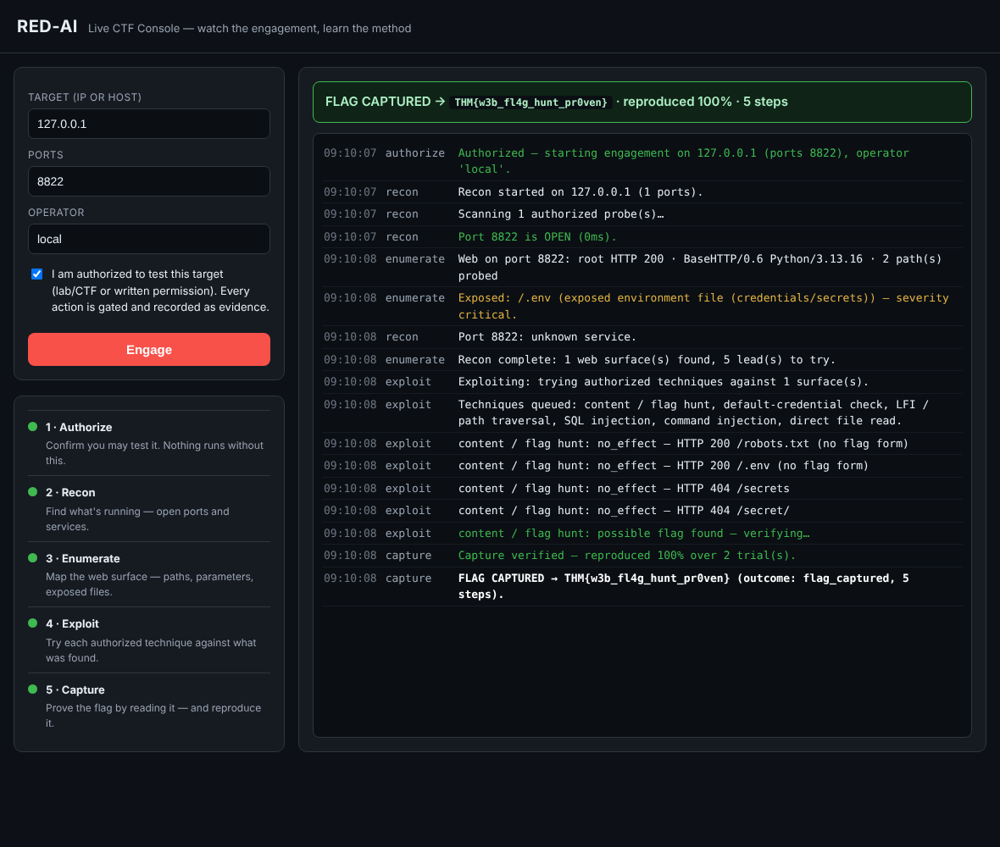

# RED-AI Web Console

A local, dependency-free web dashboard for watching an engagement run step by
step — built to **learn the method**, not just get a flag. It drives the exact
same gated, evidenced `engage_core` pipeline as the CLI and narrates every phase
in plain English: **authorize → recon → enumerate → exploit → capture**.

## Why it exists

The terminal stream is great once you know what you're looking at. The console
makes the *method* legible: a five-stage timeline that lights up as the
engagement moves, and a colour-coded feed that says what each step is doing and
why — so you can follow along and learn how a CTF is actually approached.

## Running it

It runs **on the machine that can reach the target** — the same machine on the
TryHackMe / HackTheBox VPN. The browser is only the window.

```bash
cd Red-AI
python -m red_ai web            # → http://127.0.0.1:8787
```

Open the URL, enter the target IP, tick the authorization box, press **Engage**,
and watch. (`python -m red_ai web --port 9000` to change the port.)

## What you'll see

- **Left:** target / ports / operator inputs and the authorization tick.
- **Timeline:** the five stages, lighting green as each completes.
- **Feed:** a live, annotated log — open ports, exposed files (as findings),
  which techniques were queued and tried, the capture verification, and the
  final flag with its reproduction rate.



## Security (read this)

- **Localhost only by default.** It binds `127.0.0.1`. This control panel can
  launch attacks, so do **not** expose it on the VPN/LAN. `--host` prints a loud
  warning if you point it anywhere else — only do that if you understand the
  exposure.
- **Authorization is still enforced.** The engagement needs an operator identity
  (auto-created as `local` on first launch) and the explicit "I am authorized"
  tick, both recorded in the evidence. Every exploit step is gated exactly as in
  the CLI; the web layer adds convenience, never authority.
- **Same evidence, same honesty.** Each run still writes the hash-linked
  `events.jsonl` under `data/runs/…`; the console is a read-only observer of
  that stream (an observer error can never corrupt or block the record). Verify
  and report from the CLI as usual (`python -m red_ai verify <run>`).

## Scope

The console captures what the engine can reach today (the L1–L8 web range:
exposed files, discovery-driven reads, default credentials, and single-step LFI /
SQLi / command injection). For a box that needs a shell + privilege escalation,
it will recon and probe honestly and show `no_breach` — signal, not "secure".
See [`CAPABILITY_RANGE.md`](CAPABILITY_RANGE.md) and [`THM_RUNBOOK.md`](THM_RUNBOOK.md).
